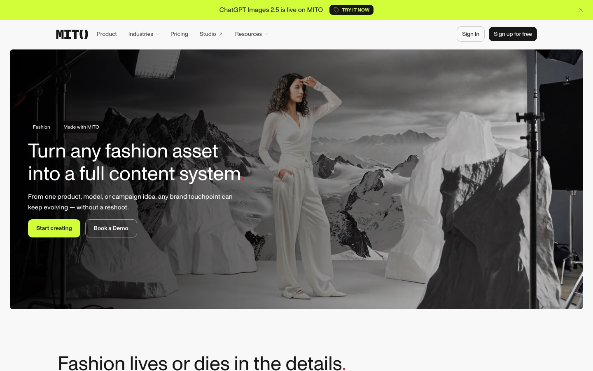
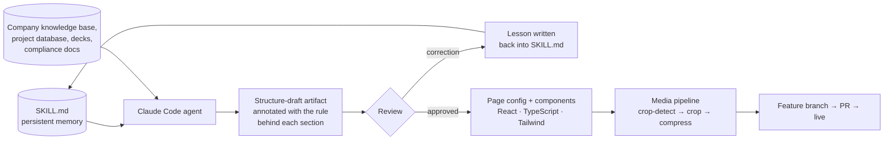
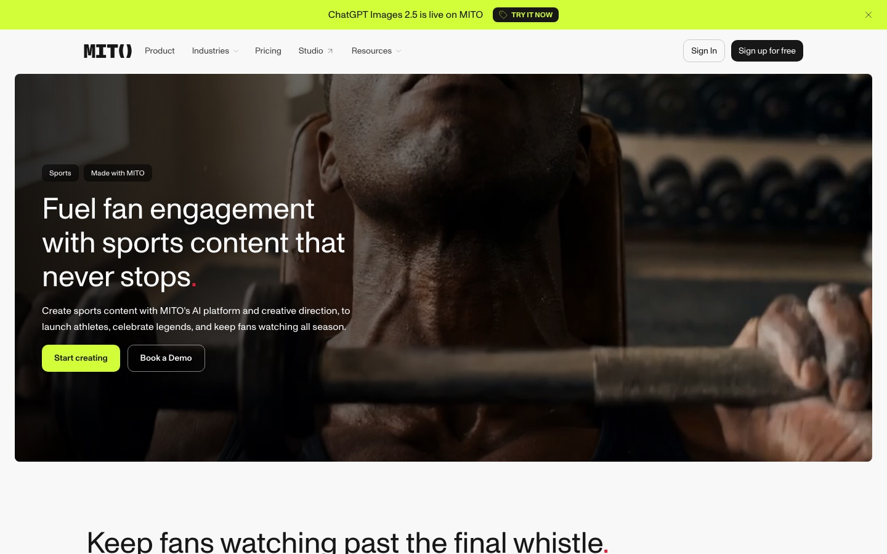
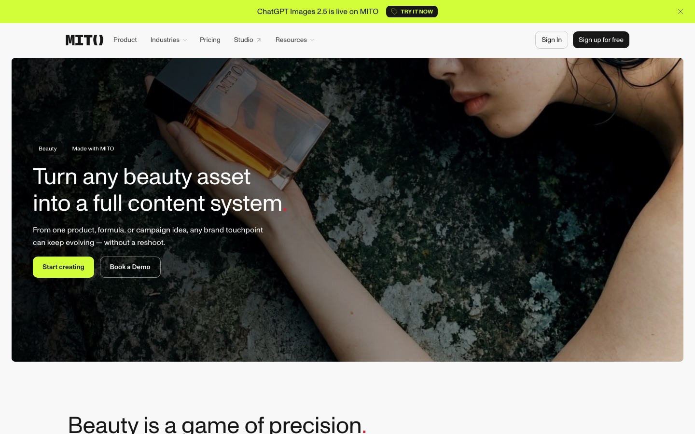
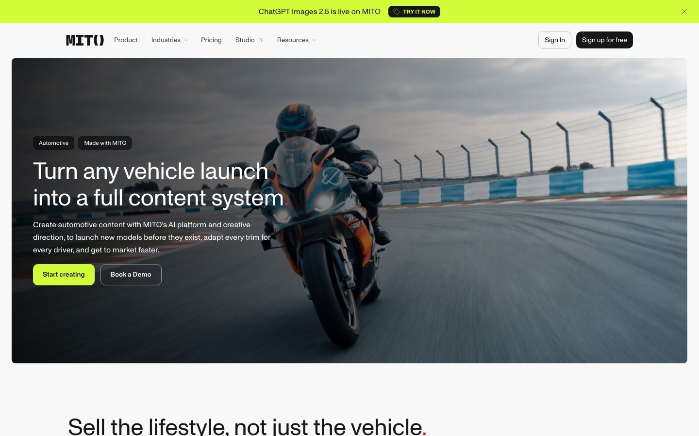
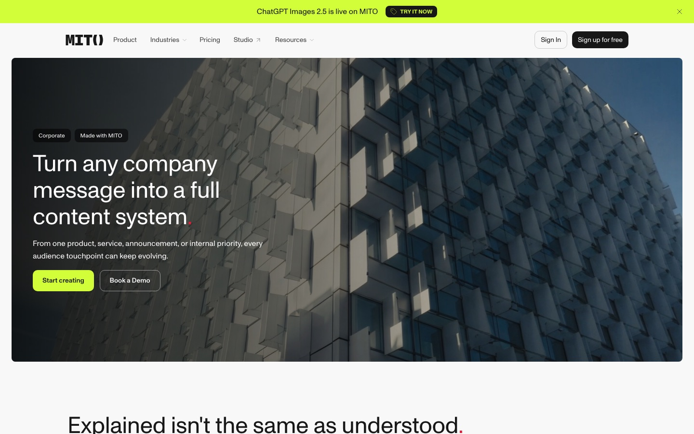

# Agentic Landing-Page Playbook

**How I automated shipping new landing pages for [mito.ai](https://mito.ai) with an AI coding agent.** A Claude Code skill gives the agent persistent memory of the page architecture, content rules, design system and every past correction, so a new industry page goes from brief to live PR with content and review, not new code. Six pages are live so far.

I did this during my 2026 internship at [Mito](https://mito.ai), a generative-AI video platform. The company needed a landing page for every industry it sells to. Each page had to match the live site's design system, use only claims the company could stand behind, and show existing Mito production media and clearly labeled concept work instead of stock visuals.

I designed the first page (Fashion) with Claude Code: its structure, content rules and design decisions. The web team shipped the initial implementation and shared page components, and I then redesigned and refined it in code. Every decision, correction and failure along the way went into a **skill**, a structured playbook the agent loads before it starts working. I then built the next five pages (Sports, Beauty, Automotive, Travel and Corporate) on the shared system with the skill, and each one fed new lessons back in.

| Page | Live |
|---|---|
| Fashion | [mito.ai/industries/fashion](https://mito.ai/industries/fashion) |
| Sports | [mito.ai/industries/sports](https://mito.ai/industries/sports) |
| Beauty | [mito.ai/industries/beauty](https://mito.ai/industries/beauty) |
| Automotive | [mito.ai/industries/automotive](https://mito.ai/industries/automotive) |
| Travel | [mito.ai/industries/travel](https://mito.ai/industries/travel) |
| Corporate | [mito.ai/industries/corporate](https://mito.ai/industries/corporate) |



---

## The idea: give the agent persistent memory

An AI agent doesn't carry what it learned in one session into the next. Without a written memory, page six would likely repeat the mistakes from page one: inventing features, padding a list with vague deliverables, rendering an unstyled component, claiming a certification the company doesn't hold.

The fix was to treat the agent's knowledge as an artifact that persists between sessions. [`playbook/SKILL.md`](playbook/SKILL.md) is a Claude Code skill. The agent loads it automatically whenever a task matches its description, and it holds:

- **A 7-section page architecture:** Hero, Why, Deliverables, Features, Proof, Enterprise and CTA, with the job of each section and hard rules about what belongs where. For example, the "Why" section names value and never product names, so it can't duplicate the Features section.
- **Testable content rules** in place of vague guidance. Each deliverable card must pass one question: *"Can you point to a specific thing that gets made, or is it a genre or audience descriptor dressed up as a deliverable?"* The skill lists the real cards that failed this test and what replaced them.
- **Guardrails against hallucination:**
  - Content sources are ranked by trust, from the company knowledge base and project database down to sales decks.
  - Every security claim must be checked against compliance documentation.
  - When something can't be confirmed, the agent is told to write an explicit `[TBD]` instead of filling the gap with an invented capability, certification or client logo. Human review still checks every page.
- **The design system, measured from the live site.** Fonts, `oklch()` color tokens, the brand's accent-dot signature and button radii were all read from computed styles on the live site, not guessed.
- **A competitor teardown:** which pattern came from which site (Lovart, Flora, Luma, Runway, Artlist) and why, so later pages reuse the reasoning, not just the layout.
- **Implementation lessons from shipping the code**, such as component bugs, layout fixes and a media pipeline, written as rules the agent applies before it repeats a mistake.

## The workflow



1. **Draft structure before code.** The agent first produces a structure-draft artifact styled like the real site. Visuals are placeholders, and above every section is a note on the rule it follows and what changed. These notes are the part that makes the rules repeatable, so nothing has to be argued again on the next page.
2. **Review, then write corrections back.** Every correction became a rule in the skill, not a one-off fix. Some examples:
   - **Duplicate idea:** two sections were both saying "one campaign, all audiences," so one was cut and the rule says each idea lives in exactly one section.
   - **Feature list too heavy:** after two rejected layouts, the features became grouped labels with no descriptions, and the grouping alone does the explaining.
   - **Title out of order:** an enterprise block's copy opened with a different idea than its title promised, so the rule says copy opens with whatever the title promises.
3. **Ship as data.** Each industry is one typed entry in the site's industry config, rendered by shared page components. A new industry means new content, not new code.

## What I built

- **The skill itself:** 150 lines distilled from a long iterative build, covering architecture, content rules, guardrails, design tokens and implementation lessons. It's written so an agent can act on it without re-deriving decisions.
- **Six live industry pages**, shipped in a week (Aug 6 to Aug 12, 2026) across 13 merged commits: the industry configs plus 100+ optimized media assets.
- **Component work on the shared page patterns:**
  - **Carousel captions:** a fixed-height text overlay on the deliverables carousel, with a gradient and backdrop blur. Line clamps plus a minimum height keep titles aligned across cards whatever the caption length.
  - **Video crop control:** a `mediaPosition` option so video isn't cropped through a subject's head.
  - **Proof strip:** a frosted "Play" link to each project's source video.
  - **Enterprise blocks:** a text-only layout carried by a hover lift instead of image placeholders.
- **A media pipeline the agent runs before committing any asset:**
  - `ffmpeg cropdetect` catches black bars baked into the pixels, which CSS `object-cover` can't remove.
  - Card and carousel clips are cropped, then compressed to H.264 with `-crf 28` and no audio, taking 3 to 20 MB sources down to roughly 60 to 600 KB. Hero videos keep larger files and higher quality settings.
  - Images are converted to WebP at about twice their display width.
  - Raw sources are kept out of git, so there's no second generation-loss re-encode later.

## Use the playbook

Install it as a Claude Code skill:

```bash
mkdir -p ~/.claude/skills/industry-page-template
cp playbook/SKILL.md ~/.claude/skills/industry-page-template/SKILL.md
```

The skill is specific to mito.ai's site and brand, and it refers to sources that aren't in this repo: the company knowledge base, project database, compliance docs and a reference draft with the full CSS. Use it as a worked example rather than a drop-in tool. The method transfers to any multi-page build with an agent: write down the architecture, make content rules testable, give the agent ranked sources and permission to say `[TBD]`, and turn every review correction into a rule.

## Gallery

| | |
|---|---|
|  |  |
|  |  |
|  | |

---
<sub>Screenshots of the live pages on mito.ai. The site codebase, its shared page components and its asset-generation tooling belong to Mito's web team. This repo contains only the playbook and this write-up. Internal document links, company-specific compliance details and internal planning material have been generalized or removed from the skill.</sub>
